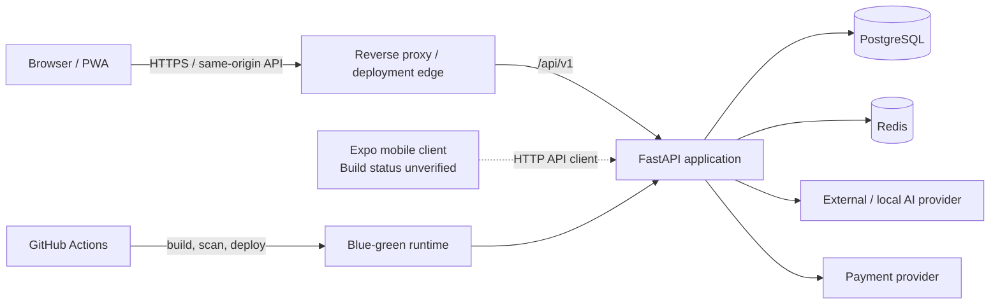
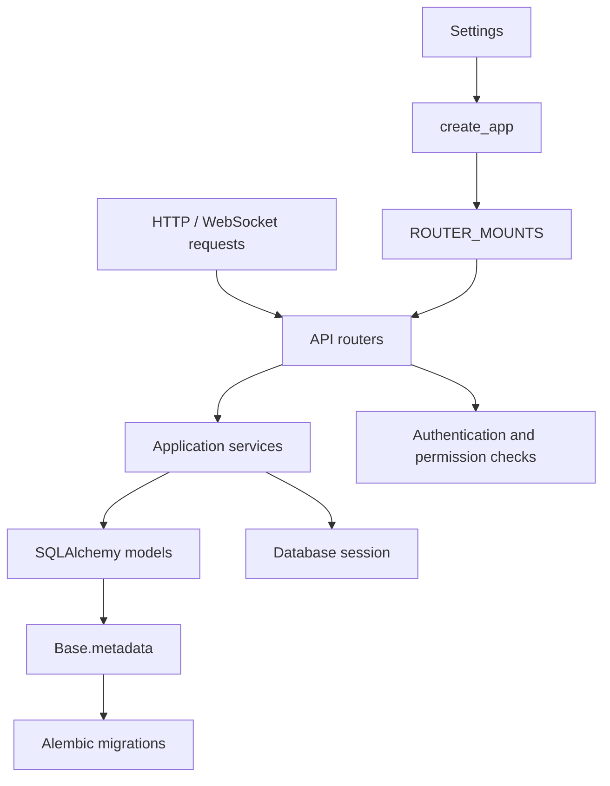

# ERP Software Architecture

**Status:** As-built architecture baseline  
**Reviewed against:** `main` at `faf7b6e921310d75fa3e3e0256814a8f55d63fa2`  
**Scope:** Architecture boundaries, runtime topology, data ownership, and safe evolution. This document describes repository evidence; it does not assert that unverified components are production-ready.

## 1. Architecture summary

ERP is currently a **modular monolith**: one FastAPI backend process exposes versioned APIs, one PostgreSQL database is accessed through SQLAlchemy, and a canonical React PWA consumes those APIs. Redis is an auxiliary runtime dependency used by selected services. A React Native / Expo mobile client exists in the repository, but its build and runtime integration are not verified by the current CI contract.

The modular monolith is the current deployment unit. Router and service modules are logical boundaries, not independently deployable services. Keep business transactions and schema ownership inside the backend until measured operational or organizational needs justify another boundary.

## 2. System context and runtime topology

The diagram shows repository integrations and intended request paths, not proof that every optional integration is enabled in every environment. Confirm actual environment variables, credentials, and deployment state before operational changes.

### Runtime components

| Component | Current repository evidence | Architectural responsibility |
|---|---|---|
| Backend API | `backend/app/main.py`, `backend/app/routers/` | HTTP/WebSocket entry point, API composition, middleware |
| Application configuration | `backend/app/config.py` | Pydantic Settings, environment validation, production secret checks |
| Persistence | `backend/app/database.py`, `backend/app/models.py` | SQLAlchemy engine/session and ORM metadata |
| Schema evolution | `backend/alembic/` | Ordered, versioned database migrations |
| Authorization | `backend/app/permissions_catalogue.py`, `backend/app/services/permissions.py` | Permission catalogue and runtime permission checks |
| Backend services | `backend/app/services/` | Reusable business/service operations |
| Canonical web client | `backend/frontend-react/` | React 18 + Vite PWA |
| Mobile client | `mobile/` | Expo / React Native client; not covered by current CI build |
| Runtime delivery | `.github/workflows/ci.yml`, `scripts/deploy-blue-green.sh` | CI gates and blue-green deployment path |

## 3. Backend architecture and dependency direction

### Existing conventions to preserve

1. **Application composition:** `create_app()` is the sanctioned FastAPI factory. `ROUTER_MOUNTS` is the single router registration table used by the factory and module-level application.
2. **API versioning:** business API routers are mounted under `/api/v1`; health endpoints also have root-level aliases.
3. **Authorization source of truth:** permission resources, actions, and role grants are declared in `permissions_catalogue.py`. Runtime permission helpers live in `services/permissions.py`.
4. **Persistence metadata:** all ORM models currently live in `app/models.py`. Alembic imports that module to populate `Base.metadata`; splitting models requires deliberate updates to model imports and migration metadata loading.
5. **Database access:** the current implementation uses synchronous SQLAlchemy `Session` / `sessionmaker`. Do not describe or migrate it as async persistence without an explicit, tested migration plan.
6. **Configuration:** use typed `Settings`; production validation rejects placeholder/weak secret configuration. Do not introduce parallel environment-variable readers.
7. **Service boundaries:** routers should remain transport/adaptation layers; reusable business rules belong in services. Avoid router-to-router imports and hidden cross-module side effects.

### Logical module map

The current router registry exposes authentication, CRM, HR, inventory, finance, projects, AI, documents, reports, workflows, payments, integrations, analytics, administration, WebSocket, search, permissions, LLM, Jev-Intercept, and health capabilities. These are logical capabilities inside one backend application; they are not separate services or separate databases.

## 4. Data and schema architecture

- PostgreSQL is the primary relational store configured through `DATABASE_URL`.
- SQLAlchemy models are centrally registered on `app.database.Base`.
- Alembic migrations are the authoritative schema-change mechanism. Keep migrations additive and reviewable; never use application startup code as an implicit schema migration mechanism.
- Preserve foreign-key and relationship semantics when changing models. A model refactor must be checked against the complete migration chain and existing data compatibility.
- Redis is configured through `REDIS_URL`; treat it as auxiliary state/cache infrastructure, not the system of record.
- The repository does not establish a verified tenant-isolation model, transactional outbox, event bus, or cross-service data contract. Do not assume these exist or add them as architecture prerequisites without a concrete requirement.

### Data change sequence

1. Define the invariant and compatibility requirement.
2. Add or modify an Alembic migration with a safe upgrade path.
3. Update the ORM model and service logic.
4. Add regression tests for persistence, permissions, and affected API behavior.
5. Verify both a clean migration chain and upgrade from the supported prior schema.
6. Document any operational backfill or rollback limitation.

## 5. Frontend and client architecture

### Canonical web application

- Source root: `backend/frontend-react/`.
- Runtime stack: React 18, Vite, JSX, and the PWA service worker.
- `src/App.jsx` owns authentication-aware route composition.
- `src/components/Layout.jsx` owns the shared navigation/account shell.
- API access should go through the shared client in `src/api/axios.js`; do not add parallel raw Axios/fetch clients.
- Frontend configuration currently reads `VITE_API_URL` (default `/api/v1`). Add environment variables only when they are wired, documented, and tested.
- Keep the canonical frontend in this location; do not recreate a root-level `frontend/` tree.

### Mobile application

The `mobile/` tree contains Expo/React Native source, screens, navigation, Zustand stores, and an API utility. The repository's agent instructions report no `app.json` and no mobile build in CI. Therefore mobile is a present source tree but an **unverified client**, not a production-supported deployment target. Establish a reproducible Expo configuration, dependency compatibility, API contract tests, and CI build before promoting its support status.

## 6. Security and operational boundaries

- Authentication and authorization are separate concerns: authenticate the caller, then enforce a catalogue-backed permission at the protected operation.
- Keep secrets outside source control. Use the repository's typed settings and deployment secret contract.
- Preserve restrictive CORS configuration and production fail-closed settings validation.
- Use the existing Gitleaks, quality, test, CodeQL, and Trivy workflow stages. Container scanning is currently advisory where the workflow config says so; do not represent it as a blocking security gate.
- Deployments use the repository's blue-green script and GitHub Actions environment/secret gates. A skipped deploy due to missing deployment credentials is not proof of a successful deployment.
- Container behavior and Kustomize overlays must be verified through their actual CI/deployment path; local container execution may not be available in all development environments.

## 7. Quality attributes and architecture rules

| Attribute | Required engineering rule |
|---|---|
| Correctness | Preserve API behavior, authorization checks, and database invariants before optimizing |
| Modularity | Enforce logical module ownership within the monolith; avoid premature service extraction |
| Maintainability | Keep one configuration path, one API client per client app, and one permission catalogue |
| Evolvability | Version APIs and schema changes; make migrations explicit and backward-compatible where practical |
| Reliability | Test readiness, dependency failure behavior, migration upgrades, and deployment rollback |
| Security | Fail closed for production secrets and privileged operations; minimize secret exposure |
| Observability | Add structured, correlation-friendly logs and health/readiness signals where gaps are demonstrated |
| Performance | Measure query count/latency and resource use before adding caches, async layers, or distributed infrastructure |

## 8. Target evolution (gated, not pre-committed)

1. **Stabilize current boundaries:** tests for router/service ownership, authorization, migration consistency, and API contracts.
2. **Improve measurement:** establish baseline request latency, database query counts, error rates, and worker/resource utilization.
3. **Optimize within the monolith:** fix measured query and transaction bottlenecks; add indexes only with query evidence.
4. **Introduce asynchronous work selectively:** only for demonstrated long-running or retryable workflows, with idempotency and failure handling designed first.
5. **Extract a service only when justified:** require independent scaling/deployment, ownership, or fault-isolation evidence plus explicit data/API contracts and operational ownership.

No microservices, event bus, CQRS, distributed cache strategy, or Kubernetes migration is mandated by this baseline.

## 9. Known architecture risks and verification gaps

- Legacy ADR text describes React + TypeScript although the canonical frontend is JSX-only and has no TypeScript compiler step.
- Legacy ADR text describes Kubernetes with Helm; repository evidence instead contains Kustomize manifests, while the active deployment workflow uses a blue-green script. Kubernetes/Helm production operation is not established by that evidence.
- The mobile app is not built by current CI and lacks the Expo app configuration noted in repository instructions.
- The current main-branch frontend layout consumes `Outlet`, while `App.jsx` supplies route content as children. PR #152 contains a compatibility fix and regression tests; verify its merge and checks before treating the fix as part of main.
- The backend has one central ORM model module and a single migration metadata import; this is a coupling point that requires disciplined change management.
- Do not infer tenant isolation, immutable audit guarantees, payment settlement semantics, or production AI-provider availability from the presence of modules alone.

## 10. Verification checklist for architecture-affecting changes

- [ ] Backend tests pass (`cd backend && pytest -q`).
- [ ] Backend static checks pass (`ruff check . && black --check .`).
- [ ] Alembic offline chain succeeds (`cd backend && alembic upgrade head --sql`).
- [ ] Frontend tests, lint, and production build pass from `backend/frontend-react/`.
- [ ] API route and permission consistency tests pass.
- [ ] Root and backend Compose configurations are reviewed separately; do not assume the nested Compose file is active.
- [ ] CI checks pass on the exact proposed commit.
- [ ] Deployment and rollback are verified in the intended environment before production promotion.

## 11. Source-of-truth files

- `AGENTS.md` — repository layout, engineering constraints, and operational conventions.
- `backend/app/main.py` — application factory and router registry.
- `backend/app/config.py` — runtime configuration contract.
- `backend/app/database.py`, `backend/app/models.py`, `backend/alembic/env.py` — persistence and migration metadata.
- `backend/app/permissions_catalogue.py`, `backend/app/services/permissions.py` — authorization catalogue and enforcement helpers.
- `backend/frontend-react/src/App.jsx`, `backend/frontend-react/src/components/Layout.jsx`, `backend/frontend-react/src/api/axios.js` — canonical web client composition and API access.
- `.github/workflows/ci.yml`, `scripts/deploy-blue-green.sh`, `infra/k8s/` — CI, deployment, and infrastructure evidence.
